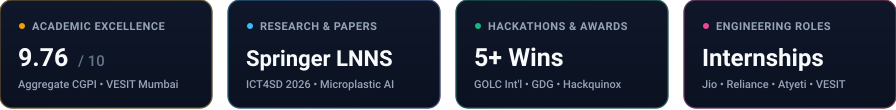
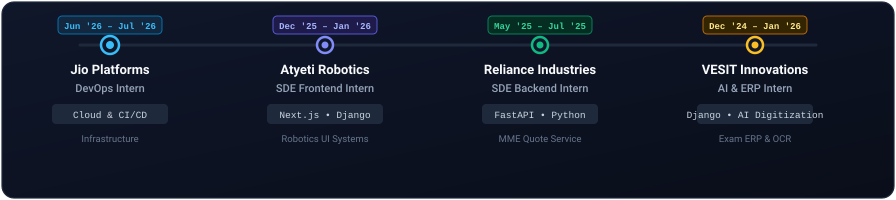
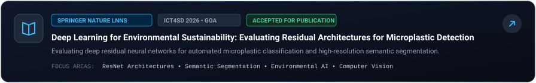
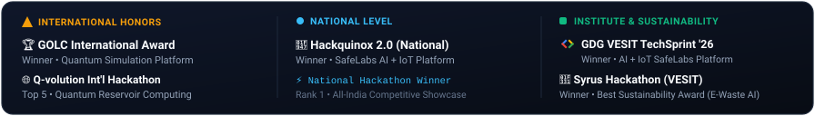

  <!-- EXECUTIVE BANNER -->
  

  

  <!-- QUICK SOCIAL & CONTACT DOCK -->
  
  &nbsp;
  
  &nbsp;
  
  &nbsp;
  
  &nbsp;
  

  

  <!-- METRIC CARDS STRIP -->
  

  

## 📌 Executive Summary

> **Software Engineer & AI Researcher** pursuing **B.Tech in Computer Engineering** at **VESIT, Mumbai** (Aggregate **CGPI: 9.76 / 10**).
>
> Passionate about engineering high-performance distributed backends, modern reactive web architectures, and applied AI systems. Proven track record across **industry engineering internships** (_Jio Platforms_, _Reliance Industries_, _Atyeti Robotics_), **peer-reviewed research published in Springer Nature LNNS**, and **first-place international and national hackathon finishes** (_GOLC International_, _GDG TechSprint_, _Hackquinox 2.0_).

---

## 💼 Work Experience

  

 

<table>
  <tr>
    <td width="50%" valign="top">
      <h3>🚀 Jio Platforms Limited</h3>
      <b>DevOps Engineer Intern</b> &nbsp;|&nbsp; <code>June '26 – July '26</code> 
      <i>Mumbai, Maharashtra, India</i>
        
      <ul>
        <li>Contributing to production DevOps workflows, CI/CD pipelines, and cloud infrastructure operations.</li>
        <li>Automating deployment reliability and container orchestration across high-throughput enterprise systems.</li>
      </ul>
      

        
        
        
      

    </td>
    <td width="50%" valign="top">
      <h3>🤖 Atyeti Robotics Private Limited</h3>
      <b>SDE (Frontend-Dev) Intern</b> &nbsp;|&nbsp; <code>Dec '25 – Jan '26</code> 
      <i>Remote / Hybrid</i>
        
      <ul>
        <li>Developed high-performance, responsive user interfaces using <b>Next.js</b> for robotics monitoring systems.</li>
        <li>Architected seamless full-stack state synchronization and RESTful API integration with a <b>Django</b> backend.</li>
      </ul>
      

        
        
        
      

    </td>
  </tr>
  <tr>
    <td width="50%" valign="top">
      <h3>⚡ Reliance Industries Limited</h3>
      <b>SDE (Python-Backend) Intern</b> &nbsp;|&nbsp; <code>May '25 – July '25</code> 
      <i>Navi Mumbai, India</i>
        
      <ul>
        <li>Engineered backend modernization by migrating legacy Flask services to <b>FastAPI</b> for the enterprise <i>MME Quote Price Upload Service</i>.</li>
        <li>Achieved substantial reductions in response latency, reinforced request schema validation, and optimized asynchronous data pipelines.</li>
      </ul>
      

        
        
        
      

    </td>
    <td width="50%" valign="top">
      <h3>🏛️ VESIT Winter Internships</h3>
      <b>Full-Stack &amp; AI Systems Intern</b> &nbsp;|&nbsp; <code>Dec '24 – Jan '26</code> 
      <i>VESIT Innovations Lab, Mumbai</i>
        
      <ul>
        <li><b>Build-a-thon 2025–26:</b> Designed and deployed an AI-enabled <i>Smart Question Paper Digitization System</i> with intelligent document parsing.</li>
        <li><b>ERP Systems 2024–25:</b> Built a production-grade web Exam Management System handling scheduling, candidate registration, and automated grading pipelines in Python-Django.</li>
      </ul>
      

        
        
        
      

    </td>
  </tr>
</table>

  

## 🔬 Peer-Reviewed Research Publication

  

 

> **Deep Learning for Environmental Sustainability: Evaluating Residual Architectures for Microplastic Detection, Classification and Segmentation**  
> _Presented at:_ **ICT4SD International Conference 2026, Goa**  
> _Publication:_ **Accepted for publication in Springer Nature LNNS (ICT Analysis and Applications - Volume 6)**
>
> **Core Contribution:** Investigated deep residual architectures (ResNet family) paired with semantic segmentation heads to accurately detect, classify, and isolate microplastic pollutants in high-noise environmental imagery, delivering automated ecological monitoring capabilities with state-of-the-art segmentation accuracy.

---

## 🏆 Featured Projects & Hackathon Winners

<table>
  <tr>
    <td width="50%" valign="top">
      <h3>🥇 SafeLabs — AI + IoT Safety Platform</h3>
      <b>Winner — GDG TechSprint VESIT (2026)</b> 
      <b>Winner — Hackquinox 2.0 (National Level)</b>
        
      <ul>
        <li>Designed an end-to-end intelligent laboratory hazard mitigation platform integrating <b>ESP32 microcontrollers</b> and environmental sensors.</li>
        <li>Deployed backend analytics on <b>Google Cloud Run</b> integrated with <b>Vertex AI (Gemini)</b> for explainable AI (XAI) proactive risk forecasting.</li>
        <li>Developed a cross-platform mobile frontend in <b>Flutter</b> for live laboratory telemetry and automated power cutoff control.</li>
      </ul>
      

        
        
        
        
      

    </td>
    <td width="50%" valign="top">
      <h3>⚛️ Quantum Playground</h3>
      <b>Winner — GOLC International Award (2026)</b> 
      <i>Interactive Quantum Computing Simulation Suite</i>
        
      <ul>
        <li>Engineered an interactive full-stack quantum circuit simulator offering <b>14 guided quantum experiments</b> (entanglement, teleportation, Shor's algorithm).</li>
        <li>Built on <b>Qiskit Aer</b> simulation backend and responsive <b>Streamlit</b> interface with secure OTP authentication.</li>
        <li>Enables intuitive visualization of Bloch spheres, quantum state vectors, and quantum gate operations for researchers worldwide.</li>
      </ul>
      

        
        
        
        
      

    </td>
  </tr>
  <tr>
    <td width="50%" valign="top">
      <h3>🌱 Re-mine-AI — Circular Economy</h3>
      <b>Winner — Syrus Hackathon VESIT (Best Sustainability Award)</b> 
      <i>Multimodal AI &amp; Blockchain E-Waste Marketplace</i>
        
      <ul>
        <li>Created a multimodal AI valuation pipeline that assesses discarded electronic hardware via computer vision to predict salvageable component yield.</li>
        <li>Matched certified e-waste recyclers using smart contracts and transparent blockchain ledger auditing.</li>
      </ul>
      

        
        
        
      

    </td>
    <td width="50%" valign="top">
      <h3>📈 Quantum Option Pricing System</h3>
      <b>Top 5 (Honorable Mention) — Q-volution Int'l Hackathon</b> 
      <i>Quantum Reservoir Computing for Quantitative Finance</i>
        
      <ul>
        <li>Formulated a quantum machine learning framework utilizing <b>Quantum Reservoir Computing (QRC)</b> to model financial volatility and option pricing.</li>
        <li>Demonstrated marked empirical convergence improvements and enhanced volatility surface predictions over classical Black-Scholes baselines.</li>
      </ul>
      

        
        
        
      

    </td>
  </tr>
  <tr>
    <td width="50%" valign="top">
      <h3>🤖 RFP Copilot — Agentic Workflow Engine</h3>
      <b>Autonomous Proposal Intelligence</b> 
      <i>LangChain • RAG • Autonomous Tool-Calling</i>
        
      <ul>
        <li>Engineered an autonomous AI agent using <b>LangChain</b> and vector stores to automate Requests for Proposal (RFP) parsing and compliance scoring.</li>
        <li>Implemented multi-step verification to evaluate criteria alignment and draft authoritative bid responses with traceable evidence.</li>
      </ul>
      

        
        
        
      

    </td>
    <td width="50%" valign="top">
      <h3>💼 Personal Finance &amp; OS Tutor Agents</h3>
      <b>Public Open Source Repositories</b> 
      <i>Interactive Learning &amp; Automated Financial Insights</i>
        
      <ul>
        <li><b><a href="https://github.com/Yash-Mahajan-28/OS-Tutor">OS-Tutor</a>:</b> Deployed pedagogical assistant on Streamlit demystifying OS memory management, CPU scheduling, and deadlocks.</li>
        <li><b><a href="https://github.com/Yash-Mahajan-28/financial-advisory-agent">Financial Advisory Agent</a>:</b> Multi-agent financial advisor synthesizing portfolio metrics, equity news, and risk profiles.</li>
      </ul>
      

        
        
        
      

    </td>
  </tr>
</table>

  

## 🛠️ Technical Competencies

  

 

<table>
  <tr>
    <td width="20%"><b>Core Languages</b></td>
    <td>
      <code>Python</code> &nbsp;•&nbsp; <code>Java</code> &nbsp;•&nbsp; <code>TypeScript</code> &nbsp;•&nbsp; <code>JavaScript</code> &nbsp;•&nbsp; <code>C/C++</code> &nbsp;•&nbsp; <code>SQL</code>
    </td>
  </tr>
  <tr>
    <td width="20%"><b>Frontend &amp; Mobile</b></td>
    <td>
      <code>Next.js</code> &nbsp;•&nbsp; <code>React.js</code> &nbsp;•&nbsp; <code>Flutter</code> &nbsp;•&nbsp; <code>Tailwind CSS</code> &nbsp;•&nbsp; <code>HTML5 / CSS3</code>
    </td>
  </tr>
  <tr>
    <td width="20%"><b>Backend &amp; APIs</b></td>
    <td>
      <code>FastAPI</code> &nbsp;•&nbsp; <code>Django</code> &nbsp;•&nbsp; <code>Flask</code> &nbsp;•&nbsp; <code>Node.js</code> &nbsp;•&nbsp; <code>RESTful Architecture</code>
    </td>
  </tr>
  <tr>
    <td width="20%"><b>AI, ML &amp; Quantum</b></td>
    <td>
      <code>PyTorch</code> &nbsp;•&nbsp; <code>LangChain</code> &nbsp;•&nbsp; <code>Vertex AI (Gemini)</code> &nbsp;•&nbsp; <code>Qiskit Aer</code> &nbsp;•&nbsp; <code>Computer Vision (ResNet)</code> &nbsp;•&nbsp; <code>Streamlit</code>
    </td>
  </tr>
  <tr>
    <td width="20%"><b>Cloud, DevOps &amp; Data</b></td>
    <td>
      <code>Docker</code> &nbsp;•&nbsp; <code>Microsoft Azure</code> &nbsp;•&nbsp; <code>Google Cloud Run</code> &nbsp;•&nbsp; <code>PostgreSQL</code> &nbsp;•&nbsp; <code>MongoDB</code> &nbsp;•&nbsp; <code>Firebase</code> &nbsp;•&nbsp; <code>Tableau</code> &nbsp;•&nbsp; <code>Git / GitHub Actions</code>
    </td>
  </tr>
  <tr>
    <td width="20%"><b>Professional Strengths</b></td>
    <td>
      <code>Analytical Problem Solving</code> &nbsp;•&nbsp; <code>Adaptive Collaboration</code> &nbsp;•&nbsp; <code>Technical Communication</code> &nbsp;•&nbsp; <code>Agile Velocity</code>
    </td>
  </tr>
</table>

  

## 🎓 Education & Certifications

<table>
  <tr>
    <td width="65%">
      <h3>🎓 Vivekanand Education Society's Institute of Technology (VESIT)</h3>
      <b>B.Tech in Computer Engineering</b> &nbsp;|&nbsp; <code>2023 – Present</code> 
      <i>Affiliated with University of Mumbai</i>
    </td>
    <td width="35%" align="right">
       
      
    </td>
  </tr>
  <tr>
    <td>
      <b>New Horizon Scholars School (NHSS), Thane</b> — Higher Secondary Education (12th Grade)
    </td>
    <td align="right">
      <b>94.00%</b> &nbsp;<code>2022 – 2023</code>
    </td>
  </tr>
  <tr>
    <td>
      <b>D.A.V. Public School, Thane</b> — Secondary School Certificate (10th Grade)
    </td>
    <td align="right">
      <b>97.60%</b> &nbsp;<code>2020 – 2021</code>
    </td>
  </tr>
  <tr>
    <td>
      <b>IBM-Coursera DevOps Professional Certification</b> — Continuous Integration, Delivery &amp; Cloud Infra
    </td>
    <td align="right">
      <code>Certified</code>
    </td>
  </tr>
</table>

---

## 🎖️ Honors, Awards & Extra-Curriculars

  

 

<table>
  <tr>
    <td width="50%" valign="top">
      <h3>🏆 Technical &amp; Innovation Laurels</h3>
      <ul>
        <li><b>Winner</b> — GOLC International Award (2026)</li>
        <li><b>Winner</b> — Hackquinox 2.0 (National Level Hackathon, 2026)</li>
        <li><b>Winner</b> — GDG TechSprint Hackathon (2026)</li>
        <li><b>Winner (Best Sustainability)</b> — Syrus Hackathon VESIT (2026)</li>
        <li><b>Winner</b> — Ideathon (2025)</li>
        <li><b>Top 5 (Honorable Mention)</b> — Q-volution International Hackathon (2026)</li>
        <li><b>Rank 2</b> — Build-a-thon VESIT (2026)</li>
        <li><b>Rank 3</b> — Winter Internship Program (2024–2025)</li>
      </ul>
    </td>
    <td width="50%" valign="top">
      <h3>🎵 Musical Pursuits &amp; Creative Arts</h3>
      <ul>
        <li><b>2nd Position</b> — Intra-College Music Competition</li>
        <li><b>Winner</b> — 2 Consecutive Institute-Level Music Examinations</li>
        <li><b>Bronze Medal</b> — Inter-School Band Competition</li>
      </ul>
      

        <i>Passionate musician and multi-instrumentalist — bringing rhythmic precision, deep creative focus, and discipline from musical performance into software architecture and systems engineering.</i>
      

    </td>
  </tr>
</table>

  

<!-- ## 📊 GitHub Analytics & Engineering Velocity

  
  &nbsp;
  

 

<!-- 

  

 

### 🐍 Contribution Activity Flow

  <picture>
    <source media="(prefers-color-scheme: dark)" srcset="https://raw.githubusercontent.com/Yash-Mahajan-28/Yash-Mahajan-28/output/github-snake-dark.svg">
    <source media="(prefers-color-scheme: light)" srcset="https://raw.githubusercontent.com/Yash-Mahajan-28/Yash-Mahajan-28/output/github-snake.svg">
    
  </picture>

  -->

---

  

    <b>Yash Mahajan</b> • Mumbai, Maharashtra, India 
    <a href="mailto:yashmahajan2809@gmail.com">yashmahajan2809@gmail.com</a> • <a href="https://www.linkedin.com/in/yash-mahajan-540963321">linkedin.com/in/yash-mahajan-540963321</a> • <a href="https://github.com/Yash-Mahajan-28">github.com/Yash-Mahajan-28</a>
  

  Crafted with modern precision, clean architecture, and rigorous engineering. © 2026 Yash Mahajan.

